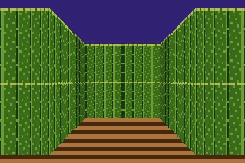
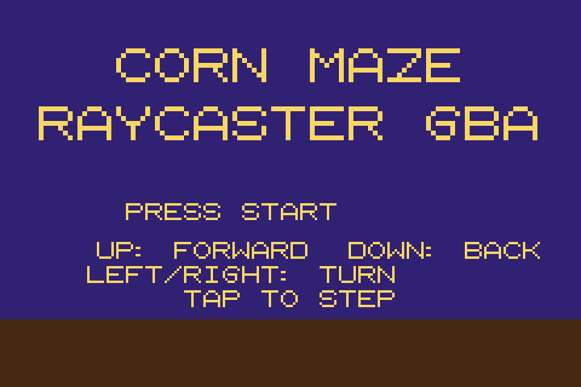
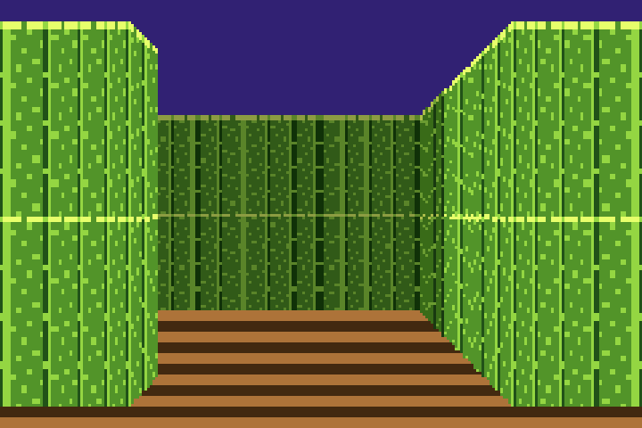
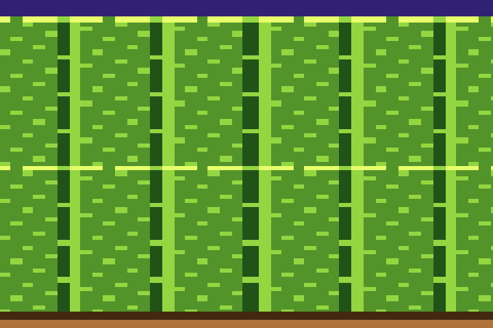

# Raycaster — GBA prototype

A first-person corn maze prototype for the Game Boy Advance. Not a full game: a small maze to walk, turn, and escape from.



## Play

Browser: https://zippy-cherry-p4th.here.now/

Or load `releases/raycaster-gba-fast.gba` in a GBA emulator.

## Controls

- Up: step forward one tile
- Down: step back one tile
- Left / Right: turn 90 degrees
- Start: start / restart
- Tap to step. Holding a direction repeats after a short pause.

Reach the clearing at the far end of the maze for the exit screen.

## Screenshots








## How it works

- Mode 4 bitmap, 240 columns, DDA raycasting with fixed-point math and table trig
- Textured corn walls with distance and side shading, walking bob
- Tile-step movement: each step and turn animates over 4 frames, then the game goes idle and renders nothing until the next tap
- Per-frame divisions are replaced by precomputed tables, and wall height is capped so a close wall never fills the whole screen
- Short PSG step / bump / exit sounds only

## Build

Requires `arm-none-eabi-gcc` and Python 3.

```sh
bash build.sh
```

This produces `raycaster.gba` and copies it to `releases/raycaster-gba.gba`. The header is patched by `fix_header.py` (title `RAYCASTER`, game code `RAYC`).

## Files

- `src/main.c` — game, raycaster, sound, title / exit screens
- `src/trig.h` — sine / cosine tables
- `src/font.h` — 8x8 font glyphs
- `src/tables.h` — precomputed DDA / wall-height / texture-step tables
- `src/crt0.s`, `gba.ld` — GBA startup and linker script
- `qa/harness.c`, `qa/render.py` — host QA harness (runs the game natively, dumps the framebuffer) and its framebuffer renderer
